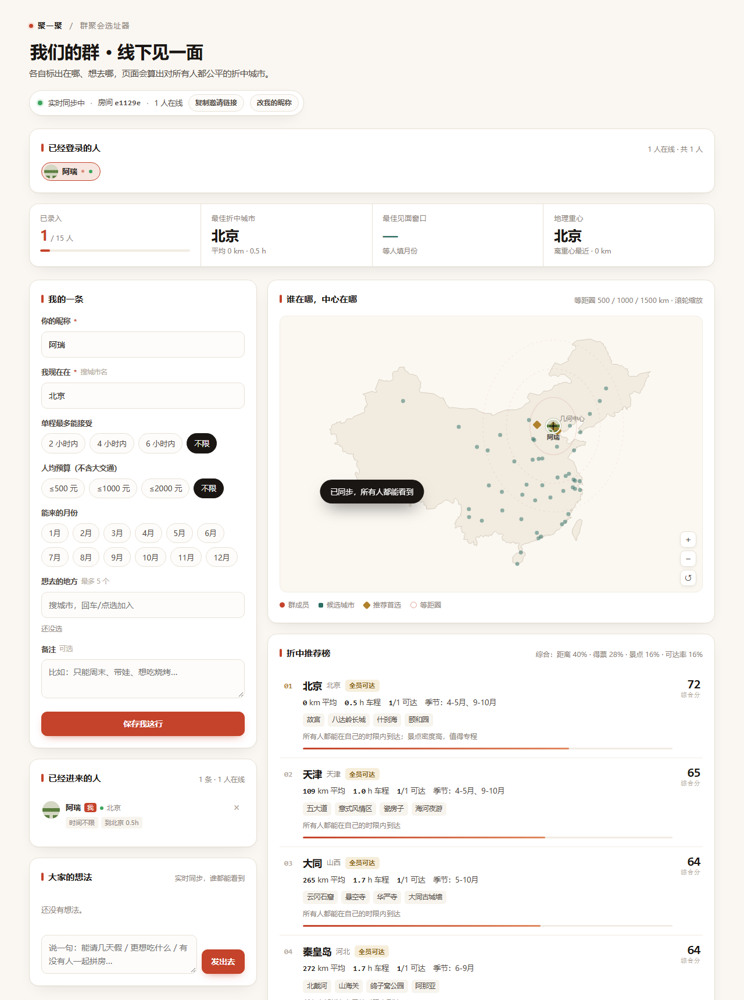

<div align="center">

# 聚一聚

### 一个群决定去哪儿见面的小工具。

每个人标出自己在哪、想去哪，页面算出对所有人都公平的折中城市。所有改动实时同步。

   

<br />



</div>

<br />

## 特性

- **折中城市推荐**：按大圆距离、估算耗时、可达率、得票与景点热度加权，给出前六名，并写明推荐理由。
- **实时同步**：改动通过 SSE 推送给所有在线成员，不需要刷新；断线自动重连，不可用时退回轮询。
- **昵称 + 身份码**：身份码是每个人自己的简单密码，第一次输入即设定，之后同昵称必须同码。
- **随机头像**：由成员 id 哈希生成 5×5 对称像素图，出现在顶部在线列表、成员列表、地图与留言中。
- **分布地图**：中国轮廓底图，成员头像标在所在城市，附 500 / 1000 / 1500 公里等距圈与几何重心，支持滚轮缩放与拖拽平移。
- **候选城市带景点**：内置 53 个交通便利的候选城市，每个配 3~4 个去处与最佳季节。
- **SQLite 持久化**：房间、成员、留言落盘，重启不丢；备份是拷一个目录。
- **单镜像部署**：GitHub Actions 构建 amd64 / arm64 镜像，推送到 GHCR。

## 技术栈

| 模块 | 选型 |
| --- | --- |
| 前端 | 原生 HTML、CSS、JavaScript，单文件页面 |
| 地图 | 内联 SVG，等距圆柱投影 |
| 服务端 | Node.js 24，仅用 `node:http` |
| 数据库 | SQLite（`node:sqlite`，WAL 模式） |
| 实时 | Server-Sent Events |
| 认证 | scrypt 加盐哈希与随机 token |
| 构建 | Docker、GitHub Actions |

## 使用流程

1. 打开服务地址，填写昵称与身份码；还没有房间时点「帮我建一个」。
2. 把地址栏里 `?r=xxxxxx` 的链接发到群里。
3. 其他人点开链接，填写自己的昵称与身份码进入。
4. 各自填写所在城市、能接受的单程时长、预算、能来的月份、想去的地方。
5. 推荐榜随数据实时重排，顶部的「已经登录的人」实时增删。

## 登录与身份码

身份码是每个人自己的简单密码，4~12 位字母或数字。

- 第一次用某个昵称登录时，输入的码即成为该昵称的密码。
- 之后用同一昵称登录，身份码必须一致，否则拒绝。
- 服务端只保存 scrypt 派生值与盐，不保存明文。
- 同一昵称连续输错 10 次后锁定 5 分钟。
- 忘记身份码只能换昵称，目前没有找回入口。

## 快速开始

### Docker Compose

```bash
git clone https://github.com/QCEnjoyLL/meetup-picker.git
cd meetup-picker
docker compose up -d
```

### Docker CLI

```bash
docker pull ghcr.io/qcenjoyll/meetup-picker:latest

mkdir -p ./data

docker run -d \
  --name meetup-picker \
  --restart unless-stopped \
  -p 8080:8080 \
  -e TZ=Asia/Shanghai \
  -e PORT=8080 \
  -e DB_PATH=/data/meetup.db \
  -v "$PWD/data:/data" \
  ghcr.io/qcenjoyll/meetup-picker:latest
```

Windows PowerShell 下命令接行符与当前目录写法不同：

```powershell
New-Item -ItemType Directory -Force -Path .\data | Out-Null

docker run -d --name meetup-picker --restart unless-stopped `
  -p 8080:8080 `
  -e TZ=Asia/Shanghai `
  -e PORT=8080 `
  -e DB_PATH=/data/meetup.db `
  -v "${PWD}/data:/data" `
  ghcr.io/qcenjoyll/meetup-picker:latest
```

常用操作：

```bash
docker logs -f meetup-picker     # 查看日志
docker stop meetup-picker        # 停止
docker rm -f meetup-picker       # 删除容器（数据在 ./data 里，不受影响）
docker pull ghcr.io/qcenjoyll/meetup-picker:latest   # 更新镜像
```

默认访问地址：

```text
http://127.0.0.1:8080
```

不想等 CI，本地构建：

```bash
docker compose -f docker-compose.yml -f docker-compose.build.yml up -d --build
```

### 直接跑 Node

需要 Node.js 22.5 以上（用到内置的 `node:sqlite`）。

```bash
npm start
```

指定端口与数据库路径：

```bash
PORT=3000 DB_PATH=/tmp/meetup.db npm start
```

## 数据与备份

数据库默认在 `./data/meetup.db`，容器内为 `/data`，可用环境变量 `DB_PATH` 修改。

| 表 | 内容 |
| --- | --- |
| `rooms` | 房间号、群名、预期人数、版本号 |
| `members` | 昵称、身份码派生值、城市、预算、月份、想去的地方、token |
| `thoughts` | 留言墙内容 |

备份时先停服务，避免 WAL 尚未落盘：

```bash
docker compose stop
cp -a data data.bak
docker compose start
```

使用 `docker run` 启动时同理，数据在挂载出来的 `./data` 目录，直接拷贝即可。

## 公网部署

反代需要关闭缓冲，否则 SSE 推送会被攒成几十秒一次。

```nginx
location / {
  proxy_pass http://127.0.0.1:8080;
  proxy_http_version 1.1;
  proxy_set_header Connection '';
  proxy_buffering off;
  proxy_read_timeout 3600s;
}
```

不想开放端口时可以用 Cloudflare Tunnel：

```bash
cloudflared tunnel --url http://localhost:8080
```

## 镜像与自动构建

推送 `main` 分支或 `v*` 标签后，`.github/workflows/docker.yml` 先跑接口冒烟测试，通过后再构建镜像并推送到 GHCR。

| 项目 | 说明 |
| --- | --- |
| 镜像 | `ghcr.io/qcenjoyll/meetup-picker` |
| 平台 | `linux/amd64`、`linux/arm64` |
| 标签 | `latest`、`main`、`v1.0.0`、`sha-xxxxxxx` |
| 可见性 | public，部署时无需登录 |

发布版本：

```bash
git tag v1.0.0
git push origin v1.0.0
```

## 推荐算法

对每个候选城市计算四项指标，归一化后按权重相加。

| 指标 | 权重 | 说明 |
| --- | --- | --- |
| 平均距离 | 40% | 到所有成员所在地的大圆距离 |
| 得票 | 28% | 被多少人填进「想去的地方」 |
| 景点 | 16% | 内置热度评分，3~5 分 |
| 可达率 | 16% | 估算耗时不超过本人填写的上限 |

耗时估算：高铁按 230 公里每小时加 0.8 小时换乘；超过 1300 公里改按飞机 750 公里每小时加 2.2 小时；两端都是枢纽城市时再扣减少量时间。

权重在 `index.html` 的 `computeStats()` 中，修改数字即可。

只有两个成员时，落在两点连线上的城市平均距离相同，结果由景点分决定。人数到六人以上才有参考价值。

## 接口

| 方法 | 路径 | 说明 |
| --- | --- | --- |
| GET | `/api/ping` | 健康检查，返回房间数 |
| POST | `/api/room` | 创建房间 |
| GET | `/api/room/:id?token=` | 房间快照与当前身份 |
| POST | `/api/room/:id/join` | 以 `{name, code}` 登录，首次即建号 |
| POST / DELETE | `/api/room/:id/member` | 修改自己的资料 / 退出房间 |
| POST / DELETE | `/api/room/:id/thought` | 发布留言 / 删除自己的留言 |
| PUT | `/api/room/:id/meta` | 修改群名与预期人数 |
| GET | `/api/room/:id/stream?token=` | SSE 实时推送 |

城市库在 `index.html` 的 `CITY_RAW` 中，格式为 `城市|省|纬度|经度|枢纽等级|最佳季节|景点分|标签|景点`。非候选城市只需前 5 项。

## 项目结构

```text
meetup-picker/
├─ .github/workflows/     # 冒烟测试与多架构镜像构建
├─ docs/                  # README 截图
├─ data/                  # SQLite 数据目录（运行时生成，已忽略）
├─ Dockerfile
├─ docker-compose.yml     # 拉取 GHCR 镜像
├─ docker-compose.build.yml  # 本地构建覆盖
├─ index.html             # 页面：样式、脚本、城市数据
├─ server.js              # 服务端：静态资源、API、SSE、SQLite
├─ package.json
├─ LICENSE
└─ README.md
```

## 常用命令

```bash
npm start                                              # 本地启动
docker compose up -d                                   # 拉镜像启动
docker compose logs -f                                 # 查看日志
docker compose pull && docker compose up -d            # 更新镜像并重建容器
docker compose down                                    # 停止（数据保留）
docker compose -f docker-compose.yml -f docker-compose.build.yml up -d --build   # 本地构建
```

## 说明

- 微信登录需要企业主体、认证费用与已备案域名，本项目使用「昵称 + 身份码」，拿到邀请链接即可加入。
- 房间号只出现在邀请链接里，不参与登录。
- 距离与耗时均为估算值，用于比较城市，不能作为出行依据。

## License

[MIT](LICENSE)

<br />

<div align="center">
  <sub>© 2026 <a href="https://github.com/QCEnjoyLL">QCEnjoyLL</a></sub>
</div>
